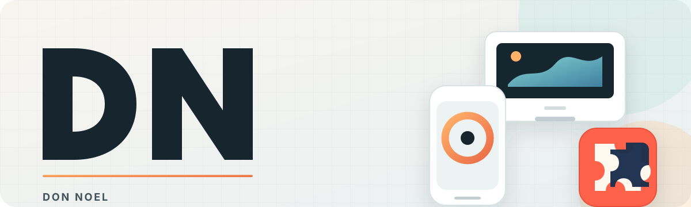
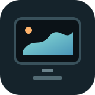
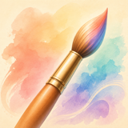
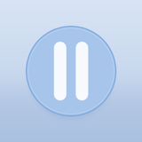
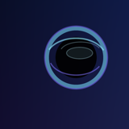
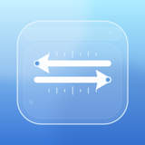

<picture>
  <source media="(prefers-color-scheme: dark)" srcset="./assets/profile-hero-dark.svg">
  <source media="(prefers-color-scheme: light)" srcset="./assets/profile-hero-light.svg">
  
</picture>

  I build practical products across Apple platforms, the web, and connected devices. 
  From shipped apps to field systems, the work stays focused, visible, and reliable.

  <a href="#spotlight"><strong>Spotlight</strong></a>
  &nbsp;·&nbsp;
  <a href="#portfolio-status"><strong>Portfolio status</strong></a>
  &nbsp;·&nbsp;
  <a href="https://apps.apple.com/us/developer/don-noel/id1852862173"><strong>App Store</strong></a>
  &nbsp;·&nbsp;
  <a href="https://github.com/donnoel?tab=repositories"><strong>All repositories</strong></a>

 

## Spotlight

<h3>&nbsp; Beam</h3>

<code>OPERATIONAL</code> <code>PRODUCTION ROLLOUT</code>

Local-first digital signage spanning a web operations console, a native iPhone and iPad companion, and resilient Raspberry Pi Players. The first customer installation is signed off, and controlled expansion is underway. 
<a href="https://donnoel.github.io/beamscreens/"><strong>Public project page</strong></a> · <a href="https://github.com/donnoel/beamscreens">Public overview</a>

<h3>&nbsp; Puzzles Puzzles Puzzles (Mosa)</h3>

<code>PRE-RELEASE</code> <code>PRIVATE BUILD</code>

A personalized photo-puzzle product with native iPhone and iPad creation, a web designer, server-rendered print artwork, guarded checkout, and human-approved fulfillment. The current work is preparing the product and its operating environment for submission and release.

<h3>&nbsp; Coloring Room</h3>

<code>SHIPPED</code> <code>APP STORE</code>

An iPad-first Apple Pencil studio for coloring, organizing, and sharing artwork, with resilient saved progress and private iCloud recovery. 
<a href="https://donnoel.github.io/Coloring/"><strong>Project page</strong></a> · <a href="https://apps.apple.com/us/app/coloring-room/id6761619332">App Store</a> · <a href="https://github.com/donnoel/Coloring">Source</a>

## Shipped on the App Store

  &nbsp;
  &nbsp;
  &nbsp;
  &nbsp;
  

  <a href="https://donnoel.github.io/Pause/"><strong>Pause</strong></a> ·
  <a href="https://donnoel.github.io/Glow/"><strong>Glow</strong></a> ·
  <a href="https://donnoel.github.io/Driftly/"><strong>Driftly</strong></a> ·
  <a href="https://donnoel.github.io/Coloring/"><strong>Coloring</strong></a> ·
  <a href="https://donnoel.github.io/Conversion/"><strong>Easy Units</strong></a>

Source:
  <a href="https://github.com/donnoel/Pause">Pause</a> ·
  <a href="https://github.com/donnoel/Glow">Glow</a> ·
  <a href="https://github.com/donnoel/Driftly">Driftly</a> ·
  <a href="https://github.com/donnoel/Coloring">Coloring</a> ·
  <a href="https://github.com/donnoel/Conversion">Easy Units</a>

  <a href="https://apps.apple.com/us/developer/don-noel/id1852862173"><strong>View the complete App Store collection →</strong></a>

## Portfolio status

Status snapshot · October 18, 2026. Private products are named without exposing their repositories or operating infrastructure.

### Shipping and operating

- <code>OPERATIONAL</code> **Beam** — Production digital signage with a web console, native operations companion, and local-first Raspberry Pi playback. [Public overview](https://donnoel.github.io/beamscreens/)
- <code>SHIPPED</code> **Coloring Room** — iPad and Apple Pencil coloring studio. [Project page](https://donnoel.github.io/Coloring/) · [App Store](https://apps.apple.com/us/app/coloring-room/id6761619332)
- <code>SHIPPED</code> **Glow Daily Practice** — Habit tracking, reminders, and widgets for iPhone and iPad. [Project page](https://donnoel.github.io/Glow/) · [App Store](https://apps.apple.com/us/app/glow-daily-practice/id6755254758)
- <code>SHIPPED</code> **Pause for a Moment** — Minimal mindfulness and breathing sessions. [Project page](https://donnoel.github.io/Pause/) · [App Store](https://apps.apple.com/us/app/pause-for-a-moment/id6755661954)
- <code>SHIPPED</code> **Driftly Night** — Ambient motion and color for iPhone, iPad, and Apple TV. [Project page](https://donnoel.github.io/Driftly/) · [App Store](https://apps.apple.com/us/app/driftly-night/id6758164205)
- <code>SHIPPED</code> **Easy Units** — Fast, reversible unit conversion for iPhone and iPad. [Project page](https://donnoel.github.io/Conversion/) · [App Store](https://apps.apple.com/us/app/easy-units/id6761770180)

### Active builds

- <code>PRE-RELEASE</code> **Puzzles Puzzles Puzzles (Mosa)** — Private native and web product for designing, ordering, and safely fulfilling personalized photo puzzles.
- <code>DEVELOPMENT</code> **Dayhand** — Private platform for bounded digital employees with visible work, evidence, permissions, and human accountability.
- <code>PILOT</code> **Red Ridge Fire Company** — Private fire-response workflow with completed demo implementation for individual OF-297 entry, review, approval, and controlled finance handoff. Client commercial approval remains unconfirmed.
- <code>ACTIVE</code> [**Tonight**](https://github.com/donnoel/Tonight) — iPad-first personal movie recommendations from a user-owned library with implemented private CloudKit library sync.
- <code>ACTIVE</code> [**Chicane**](https://github.com/donnoel/Chicane) — Friendly Formula 1 and MotoGP podium picks with exact scoring. [Project page](https://donnoel.github.io/Chicane/)

### Completed current work

Don confirmed Tick and ProjectPilot complete on October 18, 2026, with nothing outstanding from his perspective. These labels record owner closeout, not a new release or independently performed acceptance tests.

- <code>OWNER-CONFIRMED COMPLETE</code> [**Tick**](https://github.com/donnoel/Tick) — Timekeeping across iPhone, iPad, Apple Watch, and its Mac companion, with shareable Space reports.
- <code>OWNER-CONFIRMED COMPLETE</code> [**Project Pilot**](https://github.com/donnoel/ProjectPilot) — macOS menu-bar tool for Ticks, Codex usage, GitHub CI, development backups, and system health.

### Labs and tools

- <code>EXPLORATION</code> [**Loom**](https://github.com/donnoel/Loom) — Private, offline-first local AI workspace for macOS. [Project page](https://donnoel.github.io/Loom/)

### Archived projects

Archived on October 18, 2026; code, history, public visibility, and issues are preserved. Archiving does not mean unresolved bugs were fixed.

- <code>ARCHIVED</code> [**Agents House**](https://github.com/donnoel/AgentsHouse) — Permission-bounded AI residents for macOS. [Project page](https://donnoel.github.io/AgentsHouse/)
- <code>ARCHIVED</code> [**Briefly**](https://github.com/donnoel/Briefly) — Focused study decks, sessions, and reviewed content generation. [Project page](https://donnoel.github.io/Briefly/)
- <code>ARCHIVED</code> [**Ketch**](https://github.com/donnoel/Ketch) — A small SpriteKit arcade loop. [Project page](https://donnoel.github.io/Ketch/)
- <code>ARCHIVED</code> [**Pulseboard**](https://github.com/donnoel/Pulseboard) — Map-first view of live public safety and natural-event signals. [Project page](https://donnoel.github.io/Pulseboard/)
- <code>ARCHIVED</code> [**Garmin Watch Faces**](https://github.com/donnoel/Garmin) — Custom Connect IQ watch-face experiments.
- <code>ARCHIVED</code> [**Glow for Android**](https://github.com/donnoel/GlowAndroid) — Jetpack Compose translation of Glow's daily-practice rhythm. [Project page](https://donnoel.github.io/GlowAndroid/)

## How I build

**Understandable software.** Interfaces and systems should make their state clear without asking people to reverse-engineer them.

**Focused iteration.** Small changes, explicit boundaries, accessibility, and human review keep useful products maintainable.

**Reliable delivery.** Validation, recovery paths, and honest readiness matter as much as the happy path.

SwiftUI · SpriteKit · Kotlin · Jetpack Compose · Next.js · AWS · Raspberry Pi

